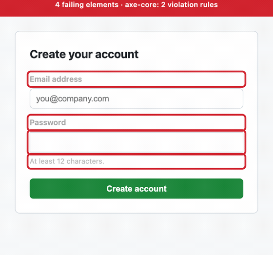
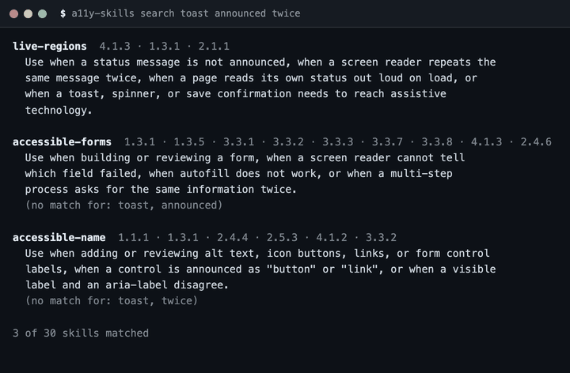

# a11y-skills

**WCAG 2.2 procedures for coding agents — and an audit command that tells you which
one to read.** 33 skills covering **every Level A and Level AA success criterion** in
WCAG 2.2, plus a curated map from axe-core's rules to the skill that fixes them.

```bash
npx github:AdilSiddiquiHQ/a11y-skills search "dialog focus"   # find the procedure
npx github:AdilSiddiquiHQ/a11y-skills audit ./dist/index.html # scan, then read the fix
```

[](https://github.com/AdilSiddiquiHQ/a11y-skills/actions/workflows/ci.yml)
[](LICENSE)
[](#scope)
[](#whats-inside)
[](verify/wcag-2.2.json)
[](verify/fixtures)
[](CONTRIBUTING.md)

[](docs/COVERAGE.md)



<sub>`npm run demo` builds this from a real fixture. axe-core outlines what it
actually found in `before.html`, then crossfades to `after.html`. It is not
hand-drawn — the script refuses to build if the "after" fixture is not clean.</sub>

---

## The problem

Ask an agent to "make this accessible" and you get plausible, confident, wrong
output. It removes an `outline` and calls the focus ring fixed. It writes
`aria-label="button"`. It flags contrast on 24px heading text that is allowed
3:1. It cites SC 4.1.1 Parsing, which was **removed** in WCAG 2.2.

None of that is a knowledge gap you can prompt your way out of reliably. It is
the absence of a checklist with the actual numbers in it.

These are that checklist. Each skill is a procedure — when to reach for it,
ordered steps, a verification step, and the failure modes — because that is the
shape an agent can follow, and the shape a reviewer can reject in a pull request.

## Try it

```bash
npx github:AdilSiddiquiHQ/a11y-skills list
npx github:AdilSiddiquiHQ/a11y-skills search "focus ring"      # find the skill for your problem
npx github:AdilSiddiquiHQ/a11y-skills info modal-dialog        # criteria, sections, path
npx github:AdilSiddiquiHQ/a11y-skills criteria 1.4.3           # which skills cover a criterion
npx github:AdilSiddiquiHQ/a11y-skills rules color-contrast     # axe rule → the skill that fixes it
```

Then install, and your agent gets all 33:

```bash
# Claude Code → ~/.claude/skills
npx github:AdilSiddiquiHQ/a11y-skills install

# OpenCode → ~/.config/opencode/skills
npx github:AdilSiddiquiHQ/a11y-skills install --agent opencode

# Anywhere else
npx github:AdilSiddiquiHQ/a11y-skills install --dest ./my-project/.agent/skills

npx github:AdilSiddiquiHQ/a11y-skills install --dry-run        # see what would happen
```

The installer copies files. It makes no network calls, executes nothing it finds,
and will not overwrite an installed skill without `--force`. Or skip it — clone
the repo and copy `skills/*` wherever your agent reads skills from.

## Audit: close the loop

A scanner reports the rule and stops. **99 of 105 axe rules** here are mapped to the
skill that contains the fix, so one command takes you from finding to procedure:

```bash
npx github:AdilSiddiquiHQ/a11y-skills audit <file.html|https://url>
```

```
  a11y-skills audit  verify/fixtures/accessible-forms/styled-signup/before.html
  axe-core 4.14.0 · local file

  critical  label  1 node
           Form elements must have labels
           WCAG  SC 4.1.2 Name, Role, Value (A)
           read  skills/accessible-forms/  — a form control has no associated label
           also  14 other skills address this
           e.g.  input[type="password"]
                 <input type="password" name="password">
                 Element does not have an implicit (wrapped) <label>

  serious  color-contrast  3 nodes
           Elements must meet minimum color contrast ratio thresholds
           WCAG  SC 1.4.3 Contrast (Minimum) (AA)
           read  skills/fix-color-contrast/  — text contrast is below 4.5:1, or 3:1 for large text
           e.g.  .field-label:nth-child(1)
                 Element has insufficient color contrast of 2.37 (foreground color: #a8a8a8,
                 background color: #ffffff, font size: 9.8pt (13px), font weight: normal)

  2 findings across 2 rules (1 serious, 1 critical)
  2 can be looked up here, 0 cannot yet
  --fail-on serious → exit 1 (2 at or above the threshold)
```

- `--md` writes a report for a CI step summary or a pull-request comment.
- `--json` gives the findings with their skills, for another tool.
- `--wcag-only` ignores best-practice rules; `--fail-on <level>` sets the exit code.
- It reports how many findings **have no skill behind them** rather than implying
  every rule is covered, and it tells you how many results axe could not decide.

`audit` is the one command that is not self-contained: running axe-core needs
axe-core and a browser, which `npx` does not install. It says so and stops rather
than installing anything. The mapping itself needs neither:

```bash
npx github:AdilSiddiquiHQ/a11y-skills rules                 # every rule and its skill
npx github:AdilSiddiquiHQ/a11y-skills rules target-size     # one rule, with its criteria
```

The mapping is generated into [`docs/RULE-MAP.md`](docs/RULE-MAP.md) and validated
against data it cannot edit — see [Verified, not asserted](#verified-not-asserted).

## Or run it in CI

[`action.yml`](action.yml) wraps the audit for GitHub Actions, so a repository can
fail a pull request on real findings and get the fixing skills in the job summary:

```yaml
- uses: actions/checkout@v4
- run: npm ci && npm run build
- uses: AdilSiddiquiHQ/a11y-skills@v0.3.0
  with:
    target: ./dist        # a file, a directory of HTML, or an https:// URL
    fail-on: serious      # critical | serious | moderate | minor | none
```

The action installs axe-core and Chromium with `--no-save`, writes a Markdown
report to the job summary, and needs no token and no secrets. It audits what you
built rather than what you wrote, which is where the difference usually is. Full
options in [`docs/ACTION.md`](docs/ACTION.md).

## What's inside

33 skills. The full generated index with every trigger and every criterion
mapping is in [`skills/README.md`](skills/README.md).

| Area | Skills |
|---|---|
| **Start here** | [`audit-component`](skills/audit-component/) · [`triage-automated-results`](skills/triage-automated-results/) · [`wcag22-new-criteria`](skills/wcag22-new-criteria/) · [`screen-reader-test-plan`](skills/screen-reader-test-plan/) |
| **Text and colour** | [`fix-color-contrast`](skills/fix-color-contrast/) · [`forced-colors-and-dark-mode`](skills/forced-colors-and-dark-mode/) · [`accessible-name`](skills/accessible-name/) · [`svg-and-icons`](skills/svg-and-icons/) |
| **Controls and forms** | [`accessible-forms`](skills/accessible-forms/) · [`accessible-authentication`](skills/accessible-authentication/) · [`combobox-autocomplete`](skills/combobox-autocomplete/) · [`keyboard-focus`](skills/keyboard-focus/) · [`pointer-and-gestures`](skills/pointer-and-gestures/) |
| **Widgets** | [`modal-dialog`](skills/modal-dialog/) · [`tabs`](skills/tabs/) · [`accordion-disclosure`](skills/accordion-disclosure/) · [`menu-button`](skills/menu-button/) · [`tooltip-popover`](skills/tooltip-popover/) · [`carousel`](skills/carousel/) · [`progress-and-loading`](skills/progress-and-loading/) · [`live-regions`](skills/live-regions/) |
| **Structure and page** | [`headings-and-landmarks`](skills/headings-and-landmarks/) · [`semantic-html`](skills/semantic-html/) · [`page-title-and-language`](skills/page-title-and-language/) · [`skip-links`](skills/skip-links/) · [`predictable-context`](skills/predictable-context/) · [`pagination-and-search`](skills/pagination-and-search/) · [`zoom-reflow-text-spacing`](skills/zoom-reflow-text-spacing/) · [`motion-and-animation`](skills/motion-and-animation/) |
| **Data and content** | [`data-table`](skills/data-table/) · [`charts-and-dataviz`](skills/charts-and-dataviz/) |
| **Specialisms** | [`media-captions`](skills/media-captions/) · [`email-html-accessibility`](skills/email-html-accessibility/) |

Every skill follows one structure — **When to use · Procedure · Verify · Failure
modes** — and cites the success criteria it addresses. The specification is in
[`docs/AUTHORING.md`](docs/AUTHORING.md), and it is enforced, not aspirational.

## Verified, not asserted

A skills library is prose, and prose rots in ways nothing catches. So this
repository verifies four separate things, and says which is which.

**1. The citations.** `npm test` runs
[`verify/verify-skills.js`](verify/verify-skills.js), which checks every skill
against [`verify/wcag-2.2.json`](verify/wcag-2.2.json) — a machine-readable copy
of all 86 WCAG 2.2 success criteria and their levels. It fails the build when a
skill:

- cites a criterion that **does not exist** in WCAG 2.2;
- **names** one differently from the spec — SC 1.4.3 is "Contrast (Minimum)", and
  a skill calling it "Minimum Contrast" is unverifiable against the source, and
  nobody would notice by reading;
- cites **4.1.1 Parsing**, removed in 2.2 — you get a useful error, not "unknown
  criterion";
- has a `name` that disagrees with its directory, or a `description` that does not
  state when to use it (that text is what an agent matches a request against, so a
  vague one silently never triggers);
- is missing a required section or contains no example;
- leaves a **generated** file — the index, the coverage report, the rule map —
  stale.

**2. The advice.** This is the part most skills libraries skip.
[`verify/fixtures/`](verify/fixtures) holds 14 executable fixtures — pairs of real
HTML documents. `before.html` must trip the exact axe-core rules the fixture names,
and `after.html` must be **completely clean** — zero axe violations of any impact,
including best-practice rules, not merely clean of the rule under test. Running
axe-core in a real Chromium via Playwright, not jsdom, because the most common
failure is colour contrast and contrast cannot be computed without layout:

```bash
npm run fixtures
```

```
  ok    accessible-forms/input-without-label         before: label → after: clean
  ok    accessible-forms/styled-signup               before: label, color-contrast → after: clean
  ok    accessible-name/icon-only-button             before: button-name → after: clean
  ok    accessible-name/image-without-alt            before: image-alt → after: clean
  ok    fix-color-contrast/low-contrast-text         before: color-contrast → after: clean
  ok    headings-and-landmarks/content-outside-landmarks before: landmark-one-main, region → after: clean
  ok    headings-and-landmarks/skipped-heading-level before: heading-order → after: clean
  ok    modal-dialog/dialog-without-accessible-name  before: aria-dialog-name → after: clean
  ok    page-title-and-language/missing-lang-and-title before: html-has-lang, document-title → after: clean
  ok    semantic-html/heading-from-paragraph         before: p-as-heading → after: clean
  ok    semantic-html/lists-from-divs                before: list, listitem, definition-list, dlitem → after: clean
  ok    svg-and-icons/svg-without-accessible-name    before: svg-img-alt → after: clean
  ok    wcag22-new-criteria/undersized-targets       before: target-size → after: clean
  ok    zoom-reflow-text-spacing/viewport-blocks-zoom before: meta-viewport → after: clean

  14 fixtures: every "before" trips its named rules, every "after" is clean
```

Two of those — `target-size` and `p-as-heading` — are rules **axe ships disabled**,
so the fixture turns them on explicitly with `axeOptions` in `meta.json`. A test
that cannot fail is not a test.

**3. The mapping.** [`verify/rule-map.json`](verify/rule-map.json) says which skill
fixes which axe rule. That is a judgement call, and judgement is what to be
suspicious of, so every entry is checked against three things it cannot edit:

1. the rule must exist in [`verify/axe-rules.json`](verify/axe-rules.json), a
   committed snapshot of axe-core 4.14's rule list;
2. the skill must exist;
3. **the skill must declare at least one of the criteria axe tags the rule with.**

The third check is the one that bites. Mapping `color-contrast` to a skill that
does not address SC 1.4.3 fails CI, because the skill's own `**Criteria:**` line is
the ground truth and the map is not. Building it caught four wrong guesses.

**4. The numbers.** The coverage report, the index and the rule map are generated,
and the verifier regenerates and diffs them, so a claim in this README cannot drift
from the skills it describes.

<details>
<summary>The full content-verifier output (33 skills)</summary>

```
  ok  accessible-authentication     5 criteria, 4 sections
  ok  accessible-forms             11 criteria, 4 sections
  ok  accessible-name               7 criteria, 7 sections
  ok  accordion-disclosure          4 criteria, 4 sections
  ok  audit-component              11 criteria, 4 sections
  ok  carousel                      4 criteria, 4 sections
  ok  charts-and-dataviz            4 criteria, 4 sections
  ok  combobox-autocomplete         4 criteria, 4 sections
  ok  data-table                    4 criteria, 4 sections
  ok  email-html-accessibility      4 criteria, 4 sections
  ok  fix-color-contrast            4 criteria, 5 sections
  ok  forced-colors-and-dark-mode   5 criteria, 4 sections
  ok  headings-and-landmarks        4 criteria, 4 sections
  ok  keyboard-focus                8 criteria, 4 sections
  ok  live-regions                  3 criteria, 4 sections
  ok  media-captions                6 criteria, 4 sections
  ok  menu-button                   4 criteria, 4 sections
  ok  modal-dialog                  4 criteria, 4 sections
  ok  motion-and-animation          5 criteria, 4 sections
  ok  page-title-and-language       4 criteria, 4 sections
  ok  pagination-and-search         5 criteria, 4 sections
  ok  pointer-and-gestures          4 criteria, 4 sections
  ok  predictable-context           4 criteria, 4 sections
  ok  progress-and-loading          4 criteria, 4 sections
  ok  screen-reader-test-plan       4 criteria, 4 sections
  ok  semantic-html                 2 criteria, 4 sections
  ok  skip-links                    4 criteria, 4 sections
  ok  svg-and-icons                 4 criteria, 4 sections
  ok  tabs                          4 criteria, 4 sections
  ok  tooltip-popover               4 criteria, 4 sections
  ok  triage-automated-results      4 criteria, 4 sections
  ok  wcag22-new-criteria           9 criteria, 5 sections
  ok  zoom-reflow-text-spacing      6 criteria, 4 sections

  33 skills verified against WCAG 2.2 (86 criteria)
```

This output is pinned by [`verify/verify-readme.js`](verify/verify-readme.js): it
runs the verifier for real and fails if this README stops showing what it printed.

</details>

## Coverage

**70 of 86** WCAG 2.2 criteria are addressed by at least one skill. By conformance
level that is **100% of Level A (31 of 31) and 100% of Level AA (24 of 24)** —
every criterion a conformance claim is made against has a procedure here. AAA is
15 of 31 (48%), because most AAA criteria are editorial rather than technical.

Three things are counted separately on purpose, because collapsing them into one
number is how coverage gets overstated:

| Measure | Value |
|---|---|
| Criteria **addressed by a skill** (a procedure exists) | 70 of 86 |
| Criteria **with an executable fixture** (the fix is run) | 9 |
| Criteria **correctly absent** (no procedure can satisfy them) | 16 |

The last row is not a backlog — there is no backlog left. SC 1.2.6 Sign Language
(Prerecorded), SC 2.2.3 No Timing and SC 3.1.5 Reading Level cannot be fixed by a
design procedure, so a "skill" for them would be a list of things to ask a
different team for. The full criterion-by-criterion table, with which skills cover
what and why the rest are absent, is generated in
[`docs/COVERAGE.md`](docs/COVERAGE.md).

**"Addressed" is not "verified".** Only the fixture column is executed. Anything
that needs a keyboard, a screen reader or a human judgement says so in its own
`## Verify` section and points at
[`screen-reader-test-plan`](skills/screen-reader-test-plan/).

## CLI

| Command | What it does |
|---|---|
| `list` | Every skill, its trigger, its criteria |
| `search <words>` | Find the skill for a problem you can describe, ranked by how many of your words match |
| `info <skill>` | One skill: description, criteria with spec names and levels, sections, file path |
| `criteria [x.y.z]` | Which skills address a criterion — or the whole covered list |
| `rules [axe-rule]` | axe rule → skill, with the criteria the rule tests and why that skill |
| `audit <file\|url>` | Run axe-core and print the fixing skill for every finding |
| `install [--dest] [--agent] [--force] [--dry-run]` | Copy the skills into your agent |

`--json` works on all of them, so another tool or an agent can drive this without
screen-scraping the human output:

```bash
npx github:AdilSiddiquiHQ/a11y-skills search "forgot password" --json
npx github:AdilSiddiquiHQ/a11y-skills audit ./dist/index.html --json
```



<sub>`npm run demo:cli` runs the real CLI and renders its real stdout, so the
terminal above cannot disagree with the tool. `--no-color` and the `NO_COLOR`
environment variable are honoured for anything that pipes this into a file.</sub>

## Why not just ask the model

Fair question, and mostly the answer is "you should". A model with a good sense
of accessibility gets most of this right.

The case for a skill is the part it will *reliably* get right:

- **The numbers.** 4.5:1, 3:1, 24 × 24 CSS px, 44 × 44 for SC 2.5.5, 2 CSS px focus
  perimeter at 3:1, `#767676` as the lightest grey that passes on white. Skills
  carry the values so they are not recalled under pressure.
- **The exceptions.** Inline links are exempt from target size. Large text is
  3:1 (≥24px, or ≥18.66px bold). Empty `alt` is correct for decorative images.
  Logos and incidental photography are exempt from contrast. Getting these wrong
  produces false findings, and false findings are why accessibility tooling gets
  ignored.
- **The removals.** 4.1.1 Parsing is gone; a checklist that still includes it
  marks working code as broken.
- **Reviewability.** A skill is a file in your repository that a human can read,
  diff and reject. A model's recollection is none of those things.

## Why not just run axe

Run axe — it is good, and these skills tell you to. But axe reports; it does not
decide. It will tell you `color-contrast` failed without telling you which of the
three ways to fix it keeps your brand colour. Three things the scan does not say:

- **It does not check target size unless you ask.** axe ships `target-size` — the
  only automated check for SC 2.5.8, one of the two criteria WCAG 2.2 itself
  added — **disabled by default**. A green audit says nothing about it. Ten of the
  rules mapped in this repository are off by default.
- **It still cites a criterion that was deleted.** axe tags `duplicate-id` and
  `duplicate-id-active` with SC 4.1.1, which WCAG 2.2 removed. If a tool reports a
  4.1.1 failure, it is citing something that no longer exists.
- **It accepts a placeholder as a label.** axe-core's `label` rule treats a
  non-empty `placeholder` as a label, so a placeholder-only field passes a full
  audit and still fails SC 3.3.2 the moment someone starts typing.

That last blind spot is why [`accessible-forms`](skills/accessible-forms/) exists
and why its fixture is built deliberately without a placeholder — if the fixture
had used one, the harness would have reported a pass on a form that is not usable.
The suite found that by failing the way it was designed to.

| | a11y-skills | axe-core / Lighthouse | WCAG 2.2 docs | asking a model |
|---|---|---|---|---|
| Answers "what do I change" | yes | no, reports only | partly, in places | sometimes |
| Maps a finding to a fix | yes, `audit` | no | no | inconsistently |
| Carries exact thresholds | yes | n/a | yes, spread over 86 criteria | unreliably |
| Lets the fix be re-verified | yes, fixtures | yes, re-scan | no | no |
| Reviewable in a pull request | yes | config only | no | no |
| Covers keyboard and screen reader behaviour | **no — says so** | no | partly | no |
| Runtime dependency | none | browser or CI | none | the model |

## FAQ

**Does this make my site compliant?** No, and any tool claiming that is wrong.
Automated checks find on the order of a third of real accessibility problems.
This repository does not make a conformance claim about anything. It tells an
agent how to check things, not that you pass.

**Does `audit` replace axe-core?** It *is* axe-core, run in a browser, with the
findings joined to the skills here. Nothing about the scan is reimplemented, and
the version of axe it used is printed with the report.

**Which agents does it work with?** Anything that reads Markdown skills. Claude
Code and OpenCode have known destinations built into the installer; everything
else takes `--dest`. The skills are plain Markdown with two frontmatter keys, so
strict parsers accept them.

**Why is the criteria list not in the frontmatter?** Because `wcag` is not part of
the Agent Skills frontmatter, and a non-standard key is an interoperability
liability. [SkillSleuth](https://github.com/AdilSiddiquiHQ/skillsleuth) flagged it
as `SG-META-009 unknown key: wcag` on its first run over these skills, which was
correct — the skill was changed rather than the rule silenced. The criteria live
on a `**Criteria:**` line in the body instead.

**How do I know the advice is right?** In increasing strength: every criterion
citation is checked against the spec; the fixes that can be executed are executed
by axe-core in CI; the rule map is checked against both the axe snapshot and each
skill's own criteria; and each skill's failure-mode list is drawn from things that
ship in real code rather than invented. Where advice cannot be verified
mechanically, the skill says so instead of implying a pass.

**Why is AAA only 48%?** Because AAA is 31 criteria and most of them are
editorial, not technical — reading level, glossaries, sign language
interpretation. The ones a developer is actually asked for are covered, including
SC 1.4.6 Contrast (Enhanced), SC 2.5.5 Target Size (Enhanced), SC 2.1.3 Keyboard
(No Exception) and SC 2.3.2 Three Flashes.

**Is it free?** MIT. No account, no telemetry, no network calls.

## Repository layout

```
skills/<name>/SKILL.md           the product — one file per skill
verify/wcag-2.2.json             machine-readable ground truth for all 86 criteria
verify/axe-rules.json            generated snapshot of axe-core's rules and criteria
verify/rule-map.json             curated: axe rule → the skill that fixes it
verify/verify-skills.js          content gate: criteria, names, sections, freshness
verify/verify-readme.js          pins this README to real tool output
verify/axe.js                    launches Chromium, runs axe-core
verify/fixtures/                 before/after HTML pairs, run with axe-core
verify/run-fixtures.js           the fixture harness
scripts/generate-index.js        → skills/README.md
scripts/generate-coverage.js     → docs/COVERAGE.md and the coverage badge
scripts/generate-axe-rules.js    → verify/axe-rules.json
scripts/generate-rule-docs.js    → docs/RULE-MAP.md, and validates the map
scripts/make-demo.mjs            → docs/demo.gif, built from a real fixture
scripts/make-cli-demo.mjs        → docs/cli.gif, built from real CLI output
lib/chromium.js                  finding a browser, shared by the CLI and the harness
bin/a11y-skills.js               the zero-dependency CLI
action.yml                       the GitHub Action wrapping `audit`
docs/demo.gif                    generated: axe-core's findings, then the fix
docs/cli.gif                     generated: the real CLI output
docs/AUTHORING.md                the spec a skill must satisfy
docs/ARCHITECTURE.md             how the layers fit, and why
docs/ACTION.md                   using the action in CI
docs/COVERAGE.md                 generated criterion-by-criterion coverage
docs/RULE-MAP.md                 generated axe rule → skill reference
AGENTS.md                        invariants for an agent working in this repo
```

## Scope

What this is: 33 Markdown procedures, a zero-dependency CLI with an audit command,
three verifiers, an executable fixture harness, a curated rule-to-skill map, and a
machine-readable WCAG 2.2 reference.

What it is not: a conformance report, or a substitute for manual testing with
assistive technology.

## Contributing

Skills are the product, so a pull request that adds or improves one is the most
useful thing you can send. [`docs/AUTHORING.md`](docs/AUTHORING.md) is the
specification — it is enforced by the verifier, so read it first — and
[`CONTRIBUTING.md`](CONTRIBUTING.md) is the workflow. The fastest useful PR is a
new fixture: a `before.html` that fails and an `after.html` that is clean. The
second fastest is a rule-map entry for one of the six axe rules still unmapped.

This repository's own skills are scanned with
[SkillSleuth](https://github.com/AdilSiddiquiHQ/skillsleuth) in CI, so a skill
arriving with a hidden instruction or a prompt-injection payload does not merge.

## License

MIT.
